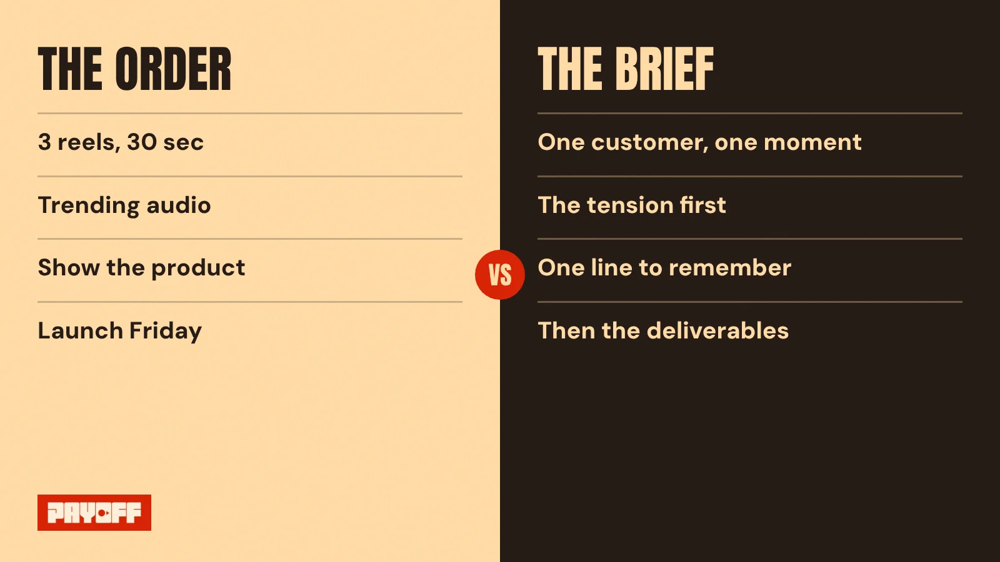
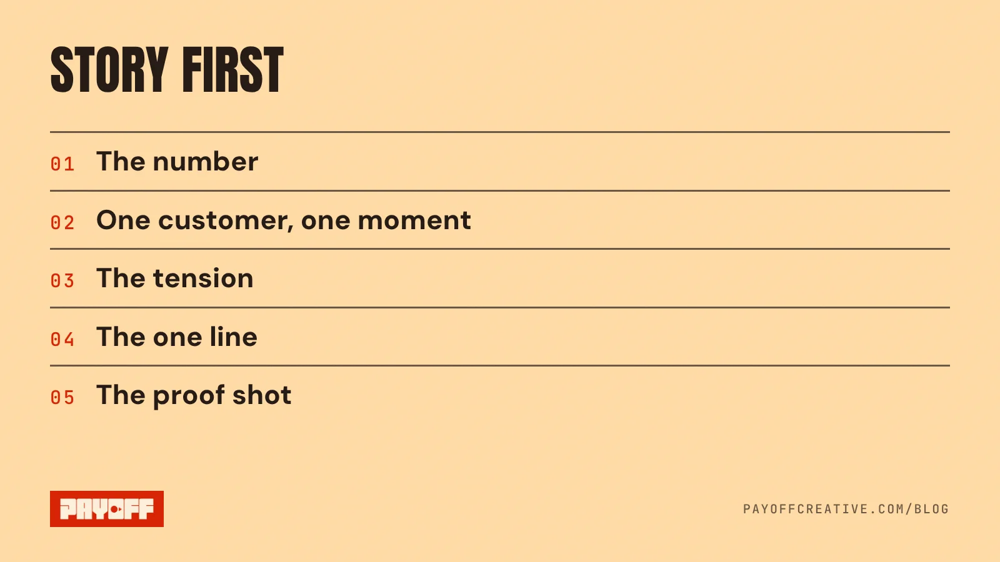

Most D2C ad briefs in India arrive as a WhatsApp message: "3 reels, 30 seconds, trending audio, show the product, launch Friday." That's an order. A creative brief template for ads should do a different job. It should tell the creator who the ad is for, what that person is feeling, and the one line they must walk away with.

Below is the one-page brief we use at Payoff, cut down to seven lines a founder can fill in ten minutes. Copy it, send it with your next order, and watch what comes back.

## Why does a list of deliverables make weak ads?

Because it leaves the story blank, and the creator fills it in with their own. Ask five creators for "3 reels showing the product" and you get five different brands, each one saying something nice and nothing in particular.

Creative decides most of what an ad earns. Nielsen's analysis of advertising effectiveness says good creative is still the most important element of an ad's sales effect, and its earlier Project Apollo study found 65% of a brand's sales lift from advertising came from the creative ([Nielsen, 2017](https://www.nielsen.com/insights/2017/when-it-comes-to-advertising-effectiveness-what-is-key/)). The brief is where that creative is decided. Everything after it is execution.

<figure class="is-wide"><figcaption>Same budget, same creator. Only one of these tells them what the ad is for.</figcaption></figure>

## The free creative brief template for ads

Fill the lines in this order. The order matters: story first, camera second, spend third.

```
1. THE NUMBER     What should this ad move? (first purchase, repeat, trial pack)
2. ONE CUSTOMER   One person, in one moment. "A working mom at 7 pm, out of time"
3. THE TENSION    What do they feel before our product shows up?
4. THE ONE LINE   The sentence they must remember. Max 10 words.
5. THE PROOF      One shot that proves the line is true.
6. BRAND CODES    What must appear, and by when? (logo, colour, sound, face)
7. NOT THIS       What this ad must not say, show or promise.
-----------------------------------------------------------------
Deliverables:     Formats, lengths, hooks needed, deadline, usage rights.
```

<figure class="is-wide"><figcaption>Lines 1 to 5 are the story. Brand codes, "not this" and the deliverables come after.</figcaption></figure>

## How do you fill in each line?

Answer each line in one sentence. If a line needs a paragraph, that's the part you haven't decided yet.

- **The number.** Pick one. An ad asked to drive sales, followers and awareness at once usually does none of them.
- **One customer.** A person and a moment, not a demographic. "Women 25 to 40" can't be filmed. "Her, at 7 pm, with dinner not started" can.
- **The tension.** This is the scene before the product. Skip it and the product has no job to do.
- **The one line.** The thing you want said back to you. If the creator only gets one sentence right, it's this one.
- **The proof.** One shot, not a montage. The stain coming out, the jar opening with one hand, the fabric after ten washes.
- **Brand codes.** Say what the viewer must see in the first three seconds with the sound off. If nobody could name your brand from a paused frame, the ad is working for your category, not for you.
- **Not this.** The claims you can't back, the competitor you won't name, the tone you hate. It saves a reshoot.

Then, and only then, list the deliverables. Formats, lengths, how many hook versions, the deadline, and how long you can use the footage. The order message isn't wrong. It's just the last line of the brief, not the first.

## What does this look like on set?

From eight years on set and in the edit, the same pattern holds: when a shoot goes wrong, the trouble was usually on page one. A crew can light anything and an editor can cut anything. What they can't do is guess the one line you meant to say.

So at Payoff, the one line gets written before a camera is booked. When the line is clear, a shoot day gets simpler, not bigger: fewer setups, fewer "let's also try" shots, and an edit that knows what to keep. When it's missing, you pay for it twice, once on set and again in the edit.

The brief also makes many creators work as one brand. Keep lines 2 to 4 fixed for every creator you hire. Let them change the room, the face and the way they say it. That's how ten ads build one memory instead of ten. We wrote more about that idea in [brand storytelling for D2C brands](/blog/brand-storytelling-for-d2c-brands/), and about choosing a format in [UGC ads vs brand films](/blog/ugc-ads-vs-brand-films/).

## Write the line before you write the order

Before your next creator order goes out, fill in line 4. Ten words, no adjectives you'd find on a competitor's pack. If you can't write it, the ad isn't ready to shoot, however good the creator is.

If you'd like a second pair of eyes on a brief or an ad that's already live, ask for our [free 60-second teardown](/#teardown). We'll tell you what the story is, and what it's missing.
