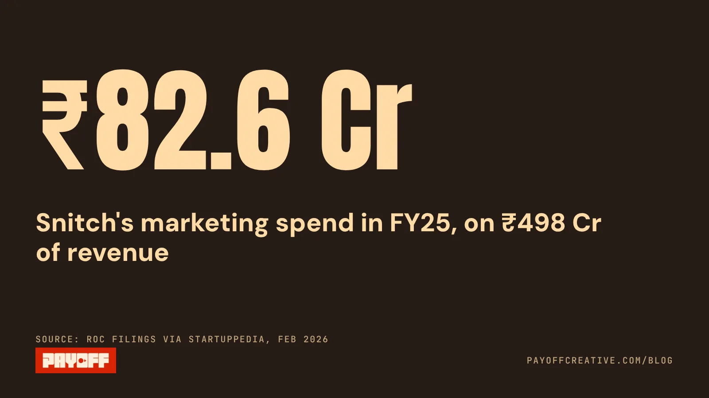
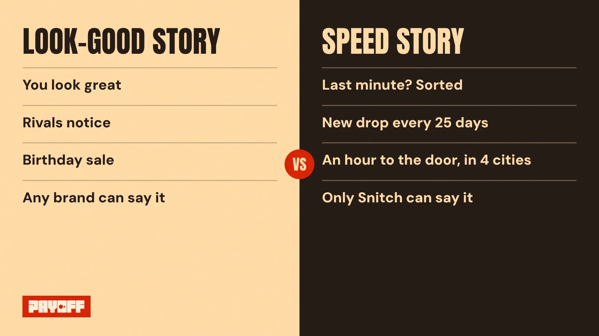
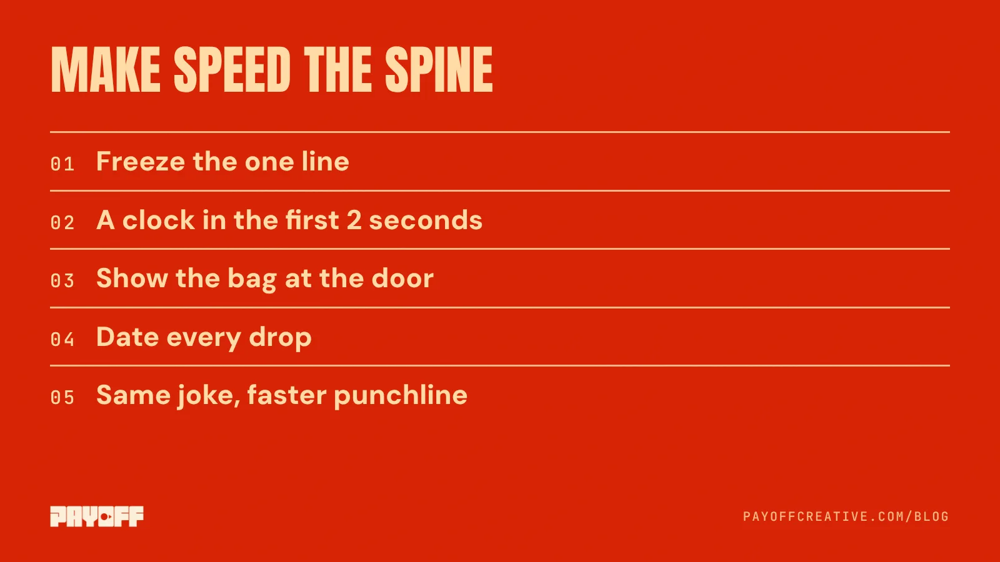

Snitch's marketing strategy runs on one of the fastest machines in Indian menswear. New styles land roughly every 25 days. In some cities, an order can reach you in an hour. And for one campaign in June 2025, the brand said exactly that, out loud, with a line anyone could repeat.

Then it moved on. The campaigns that followed sold looking good, being recognised and a birthday sale. All fine films. None of them is a story only Snitch can tell.

This is a Payoff teardown: a real brand with a real budget, taken apart the way we take apart our own work. Story first, camera second, spend third. And it ends, as every teardown should, on what the brand gets right.

## How big is Snitch's marketing budget?

Big enough that every story choice matters. Snitch reported ₹498 crore of operating revenue in FY25 and a marketing expense of ₹82.6 crore, up from ₹35 crore the year before, according to [its RoC filings as reported by Startuppedia](https://startuppedia.in/trending/startup-news/shark-tankfeatured-fast-fashion-menswear-brand-snitch-doubles-revenue-to-rs-506-crore-in-fy25-slips-into-a-rs-17-crore-loss-11154796). That's roughly one rupee in every six of revenue going to marketing, in a year the company posted a small net loss of ₹1.7 crore.

<figure class="is-wide"><figcaption>About one rupee in every six of revenue went to marketing.</figcaption></figure>

It's growing into that spend. Founder Siddharth Dungarwal told [Inc42 in April 2026](https://inc42.com/buzz/d2c-brand-snitchs-fy26-revenue-surges-80-to-%E2%82%B9900-cr/) that FY26 revenue reached about ₹900 crore (unaudited), with 115 stores, roughly 60% of sales online and Snitch Quick running in four cities.

Our read on numbers like these: when a brand spends this much, the media isn't the bottleneck. The story is. Every rupee buys attention. What the brand says with that attention decides whether the next rupee works harder or starts from zero.

## What does Snitch do that other menswear brands can't?

It moves fast, and it can prove it. That's the whole advantage, and it's rare.

Here's what's on the public record:

- **New styles roughly every 25 days.** [Outlook Business reported](https://www.outlookbusiness.com/news/snitch-launches-60-minute-apparel-delivery-pilot-in-bengaluru-targets-national-rollout-by-2026) the cadence when Snitch launched its 60-minute delivery pilot in Bengaluru in October 2025.
- **About 30 days from design to store.** [DFU Publications](https://dfupublications.com/index.php/news/apparel/snitch-s-30-day-fashion-cycle-where-data-and-discipline-drive-rs-520-cr-growth) contrasts this with lead times of many months at traditional fashion houses, and quotes Dungarwal: "Speed isn't chaos for us. It's structured agility."
- **Delivery in an hour, in some cities.** Snitch Quick started as that Bengaluru pilot and now runs in four cities, per the Inc42 report above.

Plenty of menswear brands have good shirts and a sharp price. Very few can say "the shirt you saw on Tuesday exists, it's new, and it can be at your door before dinner." That's a Category Entry Point, a moment of need the brand can own: *I need something new to wear, and I need it now.*

## Did Snitch ever tell the speed story in its ads?

Yes, once, and it was the right story. In June 2025 Snitch released *Last Minute? Snitch It*, three films about a sudden client pitch, an unexpected yes from a crush and a spontaneous boys' trip. [afaqs reported](https://www.afaqs.com/news/advertising/snitch-unveils-campaign-showcasing-fast-fashion-and-quick-delivery-9376841) that the films pushed delivery within 48 hours and a catalogue of 7,000+ designs.

The line works because it's a situation, not a slogan. Every guy has had the last-minute moment. The brand shows up as the answer to it. Snitch's CMO Chetan Siyal described it to [Marketech APAC](https://marketech-apac.com/snitch-verve-media-target-indias-fast-moving-urban-male-in-new-fashion-campaign/) as a campaign "for every guy who's ever had to pull it together fast."

That's a story with a villain (the clock), a hero (the guy) and a product with a job (get here in time). Most brand films have only one of those three.

## What did Snitch's campaigns say after that?

They said "you look good," in different ways. Look at the campaigns trade press covered over the following year:

| Campaign | When | The story |
|---|---|---|
| *Last Minute? Snitch It* | June 2025 | You need it now, we get it to you in time |
| *Style Recognises Style* | April 2026 | Rivals bond when they notice they both wear Snitch |
| Sixth birthday | June 2026 | You look so good, everyone thinks it's your birthday |
| Summer campaign | 2026 | Spontaneity, social moments, inclusive fashion |

[*Style Recognises Style*](https://www.mediainfoline.com/advertising/verve-media-brings-snitchs-style-recognises-style-to-cinema-screens-nationwide) ran in cinemas and on digital: an argument in a theatre, a sports rivalry and a sibling fight all melt when both sides spot the same brand. [The birthday films](https://www.impactonnet.com/more-from-impact/snitch-celebrates-sixth-birthday-with-new-campaign-15109.html) promoted the anniversary sale with the line "you look so good, everyone thinks it's your birthday." The [summer campaign](https://www.campaignindia.in/article/snitch-reframes-summer-with-lifestyle-led-campaign/4k9qdhxqj59fcvs5t1nac4s1de) was about spontaneity and shared moments.

<figure class="is-wide"><figcaption>Same humour, same cast. Only one side is a story rivals can't copy.</figcaption></figure>

None of these is bad. They're well-made, humorous, relatable. The problem is that a dozen menswear brands could run any of them with their own logo at the end. "You look good in our clothes" is the category's default story. Speed is Snitch's.

A caveat we owe you: this reads Snitch's campaigns as trade press reported them, not every ad in its account. A brand of this size runs hundreds of performance ads, and some may well carry the clock. That's exactly the check we'd run next in the Meta Ad Library.

## Why does telling your best story once cost so much?

Because memory is built by repetition, and every new story starts the count again. When a brand switches from speed to style to birthday to summer, a viewer who saw one of those films has no reason to connect it to the next.

From the edit suite, this is the pattern we see most in brands that spend well: each campaign is judged on its own, so each one is allowed its own idea. The team gets a fresh brief, the agency gets a fresh pitch, the audience gets a fresh brand. Nobody is wrong in the room. The audience is just never told the same thing twice.

The fix isn't a bigger film. It's a narrower brief. Our order at Payoff is story first, camera second, spend third. If the story is "we get you there in time," then the birthday film, the summer film and the rivalry film can all keep their humour. They just each need a clock in them.

## How we'd fix Snitch's marketing strategy: speed in every ad

Keep the formats, change the brief. Here's the move, in the order we'd work it:

<figure class="is-wide"><figcaption>None of these needs a bigger budget. They need a narrower brief.</figcaption></figure>

1. **Write the story in one line and freeze it.** Something close to "Last minute? We're faster than your plans." Every campaign brief starts by repeating it.
2. **Put a clock in the first two seconds.** A timestamp, a missed call, a calendar invite at 6:40 pm. On camera, urgency is a prop, not an adjective. It costs nothing to shoot.
3. **Make the product arrive on screen.** The delivery moment is Snitch's proof. Show the bag at the door, with the time in frame. That shot does more than any line about "48 hours."
4. **Let "new" be visible.** If styles change every 25 days, say which drop the ad is from. A dated drop turns a catalogue into a reason to check back.
5. **Keep the humour, change the punchline.** The birthday film could end on the guy who ordered at 5 pm and still made the party. Same joke, same cast, and now it's a Snitch story.

None of this needs more money. Our read: [a brand film is cheaper than most founders think](/blog/brand-film-cost-india/), and the expensive part is making one that doesn't connect to the next. It's the same logic we use for [deciding between UGC ads and a brand film](/blog/ugc-ads-vs-brand-films/): find the angle that sells, then build everything on it.

## What is Snitch doing right?

Almost everything a story needs, it already has. The machine is real: new styles roughly every 25 days, about 30 days from design to store, and an hour from order to door in some cities. Very few Indian brands can make a promise like that and keep it.

It has already found the line, too. *Last Minute? Snitch It* is one of the clearest brand stories we have seen from an Indian menswear brand. It's specific, it's a situation people live, and only a fast brand could say it with a straight face.

The buried part is consistency. Snitch told its best story once and treated it as a campaign. It should be the brand. If you want the plain-English version of why that matters, it's the whole idea behind [brand storytelling for D2C brands](/blog/brand-storytelling-for-d2c-brands/): one story, told many ways, until people tell it for you.

If you want this treatment for your own brand, start with the free [60-second teardown](/#teardown). We'll tell you which story you're already paying for, and which one you keep burying.
