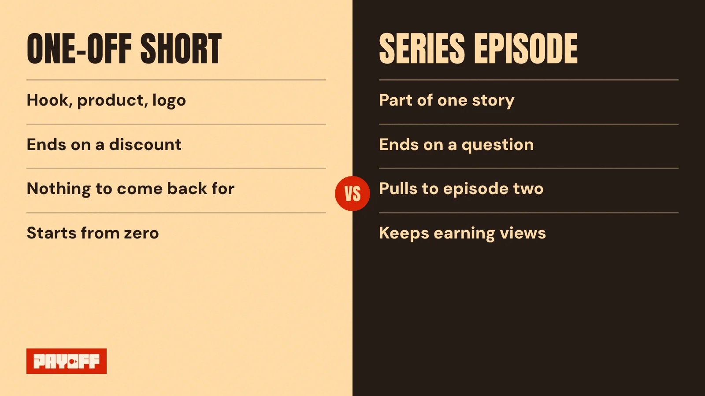
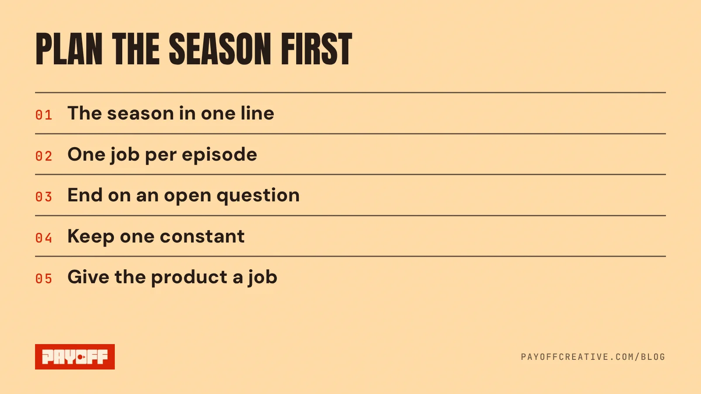

YouTube Shorts series let creators group Shorts into seasons and episodes that play in order. For Indian D2C brands, the lesson is bigger than the feature: stop making one Short at a time and start planning a season, where every episode gives people a reason to watch the next one.

On 27 October 2026, YouTube published a post on how creators build serialised microdramas, and it put Shorts series at the centre of that story. Here is what changed, who can use it, and what to do this week if you sell online.

## What are YouTube Shorts series?

A Shorts series is a set of Shorts organised into seasons and episodes, with custom thumbnails and sequential playback. YouTube says the point is to help viewers find more Shorts and keep watching ([YouTube Blog](https://blog.youtube/culture-and-trends/the-evolution-of-web-series-on-youtube-microdramas/)).

YouTube first showed the feature at Made on YouTube in September 2026. It is rolling out to creators in the YouTube Partner Program across web, mobile and connected TVs ([TechCrunch](https://techcrunch.com/2026/09/23/youtubes-new-short-series-feature-brings-episodic-viewing-to-shorts/)). YouTube has also said the launch will bring new monetisation options for creators.

In plain words: a Short no longer has to stand alone. It can be episode three of something.

## Why does this matter for Indian D2C brands?

Because the audience already watches stories in episodes on vertical video. YouTube says microdramas passed 6.5 billion views in the first half of 2026, and microdrama-related views grew more than 70% year over year in markets across APAC ([YouTube Blog](https://blog.youtube/culture-and-trends/the-evolution-of-web-series-on-youtube-microdramas/)).

The more useful number is about time. On microdramas, YouTube says 40% of views and 30% of clicks came more than 30 days after a video went live ([YouTube Blog](https://blog.youtube/culture-and-trends/the-evolution-of-web-series-on-youtube-microdramas/)). A good episode keeps working long after launch week. A one-off ad usually doesn't.

Most brand Shorts are built like tiny ads. Hook, product, logo, discount, done. There is nothing to come back for, so every new Short starts from zero.

<figure class="is-wide"><figcaption>Same product, same budget. Only one gives people a reason to come back.</figcaption></figure>

## Can a brand channel use Shorts series yet?

Only if the channel is in the YouTube Partner Program, since that is who the feature is rolling out to. To apply, a channel needs 1,000 subscribers plus either 4,000 qualified watch hours in the past 12 months or 10 million qualified Shorts views in the past 90 days ([YouTube Help](https://support.google.com/youtube/answer/72851?hl=en-GB)).

Many young D2C channels aren't there yet. That's fine. You have two honest options:

- **Publish in episodes anyway.** Number them, keep the same opening frame, and keep them together in a playlist. You build the habit before you have the button.
- **Borrow a channel that qualifies.** Brief a creator whose channel is already in the programme to run a short series with your product inside the story.

## How do you write a YouTube Shorts series for a brand?

Start with one line for the whole season, then one line per episode, before anyone picks up a camera. This is the Payoff order: story first, camera second, spend third.

<figure class="is-wide"><figcaption>Five lines on paper before anyone picks up a camera.</figcaption></figure>

1. **Write the season in one line.** "A founder tries to make chai-proof lipstick in 30 days" is a season. "Lipstick launch" is not.
2. **Give each episode one job.** Episode one sets the problem. The middle episodes test, fail, and learn. The last one pays it off.
3. **End every episode on an open question.** Not on the logo, not on a discount code.
4. **Keep one constant.** The same face, the same first frame or the same line, so viewers know they are in the same story.
5. **Let the product do a job in the story.** If it only appears as a packshot at the end, it is a cameo, not a character.

Here's a habit from eight years in the edit suite: cut each episode one beat early. Stop on the question, before the answer. The urge in the edit is to resolve everything because it feels finished. For a series, finished is the enemy. The unanswered beat is what gets the tap on episode two.

## The real change is how you plan

The feature is new. The idea isn't. People have always come back for the next part of a story, from TV serials to the long-running ad campaigns India still remembers.

What Shorts series change is the cost of being forgettable. If YouTube is now built to play your Shorts in order, a brand that only makes standalone clips is leaving the queue empty.

So this week, don't brief a single Short. Write five lines, one per episode, and check that each one ends on a question. If you want a second pair of eyes on your current Shorts, start with our [free 60-second teardown](/#teardown).

Read next: [UGC ads vs brand films: what to make first](/blog/ugc-ads-vs-brand-films/) and [brand storytelling for D2C brands, in plain English](/blog/brand-storytelling-for-d2c-brands/).
